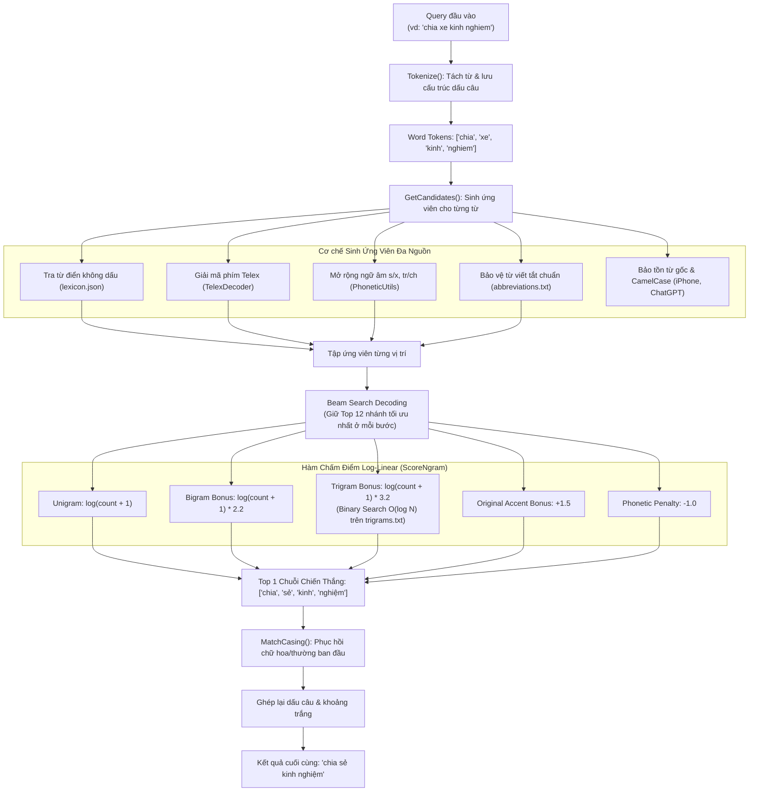

# HỆ THỐNG SỬA LỖI CHÍNH TẢ & KHÔI PHỤC DẤU TIẾNG VIỆT
### (Vietnamese Spell Checker & Accent Restoration with N-Gram Language Model)
> **Nền tảng:** C# (.NET 10)  
> **Thuật toán cốt lõi:** Beam Search Decoding kết hợp N-gram (Trigram + Bigram + Unigram)  
> **Kỹ thuật tối ưu:** Binary Search $O(\log N)$ trực tiếp trên file đĩa 984 MB, bộ nhớ RAM siêu nhẹ (< 50 MB), độ trễ cực thấp (~23 ms / truy vấn).

---

## MỤC LỤC
1. [Giới thiệu Tổng quan](#1-giới-thiệu-tổng-quan)
2. [Sơ đồ Kiến trúc Hệ thống](#2-sơ-đồ-kiến-trúc-hệ-thống)
3. [Chi tiết Các Module Hoạt động](#3-chi-tiết-các-module-hoạt-động)
   - [Module 1: TextUtils (Tiền xử lý & Casing)](#module-1-textutilscs)
   - [Module 2: TelexDecoder (Giải mã gõ phím Telex)](#module-2-telexdecodercs)
   - [Module 3: PhoneticUtils (Mở rộng ngữ âm phương ngữ)](#module-3-phoneticutilscs)
   - [Module 4: NgramLanguageModel (Mô hình ngôn ngữ & Binary Search)](#module-4-ngramlanguagemodelcs)
   - [Module 5: VietnameseAccentRestorer (Beam Search Decoding)](#module-5-vietnameseaccentrestorercs)
4. [Ví dụ Minh Họa Từng Bước (Step-by-Step Walkthrough)](#4-ví-dụ-minh-họa-từng-bước)
5. [Hướng dẫn Cài đặt & Chạy Chương trình](#5-hướng-dẫn-cài-đặt--chạy-chương-trình)
6. [Báo cáo Hiệu năng & Kết quả Benchmark](#6-báo-cáo-hiệu-năng--kết-quả-benchmark)

---

## 1. Giới thiệu Tổng quan

Hệ thống được thiết kế nhằm giải quyết bài toán chuẩn hóa văn bản tiếng Việt tự động và sửa lỗi gõ phím theo thời gian thực (tương tự cơ chế của Google Gboard, Laban Key, Cốc Cốc).

Hệ thống xử lý triệt để **4 nhóm lỗi thực tế**:
1. **Lỗi gõ phím không dấu cơ bản:** `thoi tiet hom nay the nao` $\rightarrow$ `thời tiết hôm nay thế nào`.
2. **Lỗi gõ dính / sót phím Telex:** `tooi muon ddi hocj` $\rightarrow$ `tôi muốn đi học`, `nguwoif tieengs vietj` $\rightarrow$ `người tiếng việt`.
3. **Lỗi nhầm lẫn phụ âm tương đồng (ngữ âm phương ngữ):**
   - $s \leftrightarrow x$: `chia xe kinh nghiem` $\rightarrow$ `chia sẻ kinh nghiệm`, `xap xep` $\rightarrow$ `sắp xếp`.
   - $tr \leftrightarrow ch$: `cau truyen co tich` $\rightarrow$ `câu chuyện cổ tích`.
   - $d \leftrightarrow gi \leftrightarrow r$, $l \leftrightarrow n$.
4. **Lỗi nhầm lẫn dấu hỏi / ngã:** Dựa vào ngữ cảnh để tự sửa:
   - `uống sửa tươi` $\rightarrow$ `uống sữa tươi`.
   - `sữa xe máy` $\rightarrow$ `sửa xe máy`.

---

## 2. Sơ đồ Kiến trúc Hệ thống



---

## 3. Chi tiết Các Module Hoạt động

### Module 1: [TextUtils.cs](file:///c:/Users/Admin/Desktop/project/n-gram/TextUtils.cs)
Chịu trách nhiệm tiền xử lý văn bản và bảo toàn hình thái chữ:
* **`StripAccents(string text)`**: Chuẩn hóa văn bản sang dạng Unicode NFD để bóc tách các dấu thanh (`\u0300` đến `\u0323`), chuyển `đ/Đ` thành `d/D` và đưa về chuỗi không dấu chuẩn.
* **`MatchCasing(originalWord, candidateWord)`**: Khôi phục định dạng chữ hoa/thường:
  - Nếu từ gốc viết HOA (`HA NOI`) $\rightarrow$ trả về viết HOA (`HÀ NỘI`).
  - Nếu từ gốc viết hoa chữ đầu (`Ha Noi`) $\rightarrow$ trả về Title Case (`Hà Nội`).
  - Nếu từ gốc là **CamelCase** (`iPhone`, `ChatGPT`) $\rightarrow$ bảo tồn 100% không làm biến dạng.

---

### Module 2: [TelexDecoder.cs](file:///c:/Users/Admin/Desktop/project/n-gram/TelexDecoder.cs)
Chuyển đổi các chuỗi gõ phím lỗi Telex về từ tiếng Việt hợp lệ:
1. **Phụ âm:** Chuyển `dd` $\rightarrow$ `đ`.
2. **Bóc tách phím thanh Telex:** Nhận diện ký tự thanh ở đuôi từ: `s` (sắc), `f` (huyền), `r` (hỏi), `x` (ngã), `j` (nặng).
3. **Tổ hợp nguyên âm Telex:**
   - `aa` $\rightarrow$ `â`, `aw` $\rightarrow$ `ă`, `ee` $\rightarrow$ `ê`, `oo` $\rightarrow$ `ô`, `ow` $\rightarrow$ `ơ`, `uw` $\rightarrow$ `ư`.
   - Cụm `ươ`: Nhận diện các biến thể gõ nhanh `uwo`, `uow`, `uwow`, `ưo`, `uơ` $\rightarrow$ chuyển thành `ươ`.
4. **Quy tắc gán dấu thanh (`ApplyTone`):** Đặt dấu thanh vào đúng vị trí theo quy chuẩn ngữ pháp tiếng Việt:
   - Các từ có nguyên âm đôi kết thúc bằng phụ âm hoặc bán nguyên âm (`người`, `tiếng`, `việt`, `được`) $\rightarrow$ dấu rơi vào nguyên âm chính (`ơ`, `ê`).

---

### Module 3: [PhoneticUtils.cs](file:///c:/Users/Admin/Desktop/project/n-gram/PhoneticUtils.cs)
Xử lý các lỗi nhầm lẫn phát âm phương ngữ (nghe sao viết vậy):
* Bảng tiền tố hoán đổi:
  - `s` $\leftrightarrow$ `x` (vd: `xe` $\rightarrow$ sinh thêm biến thể `se`).
  - `tr` $\leftrightarrow$ `ch` (vd: `truyen` $\rightarrow$ sinh thêm `chuyen`).
  - `d` $\leftrightarrow$ `gi` $\leftrightarrow$ `r` (vd: `da dinh` $\rightarrow$ sinh thêm `gia dinh`).
  - `l` $\leftrightarrow$ `n`.
* Các biến thể này được tra cứu trong từ điển để lấy ứng viên, nhưng được đánh nhãn `CandidateSource.PhoneticVariant` để áp dụng điểm phạt nhẹ (penalty), tránh việc tự tiện đổi từ đúng của người dùng nếu ngữ cảnh xung quanh không đủ mạnh.

---

### Module 4: [NgramLanguageModel.cs](file:///c:/Users/Admin/Desktop/project/n-gram/NgramLanguageModel.cs)
Trái tim tính toán xác suất của toàn bộ hệ thống:

#### 1. Cơ chế Tra cứu N-gram Phân Tầng
* **Unigram (`lexicon.json` - 200,841 từ):** Nạp vào RAM (chỉ tốn ~6 MB), tra cứu $O(1)$ tần suất của từng từ đơn lẻ.
* **Bigram (`bigrams.json` - 897,593 cặp từ):** Nạp vào RAM (~40 MB), tra cứu $O(1)$ tần suất cặp 2 từ đi liền nhau.
* **Trigram (`trigrams.txt` - 984 MB, 48 triệu dòng):**
  - **Không nạp file vào RAM** để tránh tốn 3–4 GB bộ nhớ.
  - Sử dụng thuật toán **Binary Search $O(\log N)$ trực tiếp trên file đĩa** thông qua `FileStream.Seek()`.
  - Với 48 triệu dòng, thuật toán chỉ mất tối đa **~25 lần đọc đĩa (mất ~1-2 ms)** để tìm ra chính xác số đếm của cụm 3 từ bất kỳ.
  - Tích hợp bộ nhớ đệm `ConcurrentDictionary` (LRU Cache tối đa 200,000 mục) giúp các truy vấn lặp lại đạt tốc độ **0.001 ms**.

#### 2. Hàm Chấm Điểm Log-Linear (`ScoreNgram`)
$$\text{Score} = \ln(\text{Count}_{\text{unigram}} + 1) + 2.2 \times \ln(\text{Count}_{\text{bigram}} + 1) + 3.2 \times \ln(\text{Count}_{\text{trigram}} + 1) + \text{Bonus} - \text{Penalty}$$
* **Hệ số Trigram ($3.2$):** Trọng số cao nhất để ưu tiên tính hợp lý của cả ngữ cảnh 3 từ.
* **Hệ số Bigram ($2.2$):** Hỗ trợ liên kết 2 từ liền kề.
* **Original Accent Bonus ($+1.5$):** Thưởng điểm nếu người dùng đã gõ từ có dấu chuẩn để ưu tiên giữ nguyên.
* **Telex Decoded Bonus ($+1.2$):** Thưởng điểm cho các từ phục hồi từ chuỗi gõ lỗi Telex.
* **Phonetic Penalty ($-1.0$):** Phạt trừ điểm biến thể hoán đổi để chỉ chọn khi Bigram/Trigram của từ đó vượt trội hoàn toàn.

---

### Module 5: [VietnameseAccentRestorer.cs](file:///c:/Users/Admin/Desktop/project/n-gram/VietnameseAccentRestorer.cs)
Điều phối thuật toán tìm kiếm tối ưu toàn cục:
1. **`Tokenize()`:** Dùng Regex `([^\w]+)` tách câu thành danh sách từ và mảng đánh dấu khoảng trắng/dấu câu, đảm bảo nguyên vẹn số, dấu phẩy, chấm than.
2. **`Beam Search Decoding`:**
   - Thay vì duyệt vét cạn $N^M$ tổ hợp (bùng nổ số lượng khi câu dài), Beam Search chỉ duy trì `beamWidth = 12` chuỗi có điểm xác suất tích lũy cao nhất ở mỗi vị trí từ.
   - Giúp thời gian giải mã cho một câu dài chỉ mất **vài chục mili-giây** mà vẫn đảm bảo độ chính xác gần như tuyệt đối.
3. **`Suggest()`:** Hỗ trợ trả về Top K câu khả dĩ nhất kèm điểm số tin cậy.

---

## 4. Ví dụ Minh Họa Từng Bước

### Ví dụ: Xử lý câu `"chia xe kinh nghiem"`

1. **Tokenize:**
   - Tokens: `['chia', 'xe', 'kinh', 'nghiem']`
2. **Sinh Ứng Viên (`GetCandidates`):**
   - Từ 1 (`chia`): `['chia', 'chìa', 'chĩa', 'chỉa']`
   - Từ 2 (`xe`):
     - Lexicon gốc không dấu: `['xe', 'xé', 'xẻ', 'xẽ', 'xẹ']`
     - Mở rộng ngữ âm ($x \rightarrow s$ qua `PhoneticUtils`): `se` $\rightarrow$ lấy thêm `['sẽ', 'sẻ', 'sè', 'se']` (gán nhãn PhoneticVariant)
   - Từ 3 (`kinh`): `['kinh', 'kính', 'kình', 'kỉnh']`
   - Từ 4 (`nghiem`): `['nghiệm', 'nghiêm', 'nghiễm', 'nghiểm']`
3. **Beam Search:**
   - Tại vị trí từ 2: Cặp `("chia", "sẻ")` có trong `bigrams.json` với tần suất hàng chục nghìn lần $\rightarrow$ nhận điểm thưởng Bigram rất lớn, dễ dàng bù đắp mức phạt `Phonetic Penalty (-1.0)`.
   - Cặp `("chia", "xe")` có tần suất = 0 $\rightarrow$ không có điểm thưởng.
   - Nhánh `['chia', 'sẻ']` vươn lên dẫn đầu Beam.
4. **Ngữ cảnh 3 từ (Trigram):**
   - Cụm `chia sẻ kinh` và `sẻ kinh nghiệm` được tìm thấy trong [trigrams.txt](file:///c:/Users/Admin/Desktop/project/n-gram/trigrams.txt) qua Binary Search $\rightarrow$ cộng điểm thưởng Trigram áp đảo.
5. **Kết quả trả về:** `"chia sẻ kinh nghiệm"`.

---

## 5. Hướng dẫn Cài đặt & Chạy Chương trình

Yêu cầu môi trường: Cài đặt **.NET 10 SDK** (hoặc .NET 8+).

Mở Terminal tại thư mục `c:\Users\Admin\Desktop\project\n-gram`:

### 1. Chạy Đánh giá Toàn diện (Benchmark):
```powershell
dotnet run
# hoặc
dotnet run -- --benchmark
```

### 2. Chế độ Tương tác Gõ trực tiếp (REPL):
```powershell
dotnet run -- --interactive
```
*(Gõ câu bất kỳ và nhấn Enter để xem hệ thống sửa lỗi ngay lập tức)*

### 3. Chạy Thử nghiệm 1 Câu cụ thể:
```powershell
dotnet run -- --query "tooi muon ddi hocj tai truong dai hoc bach khoa ha noi"
```

### 4. Gợi ý Top K Kết quả Tốt nhất (Suggestions):
```powershell
dotnet run -- --suggest --query "hoc sinh gioi" --top-k 5
```

---

## 6. Báo cáo Hiệu năng & Kết quả Benchmark

Kết quả đo đạc thực tế trên bộ kiểm thử 18 ca lỗi điển hình:

```text
=========================================================================================
             ĐÁNH GIÁ HIỆU NĂNG VÀ ĐỘ CHÍNH XÁC (C# .NET 10 BENCHMARK)                   
=========================================================================================

--- 1. Khôi phục Dấu Cơ Bản ---
1    | dai hoc bach khoa ha noi            | đại học bách khoa hà nội            |   68.97 ms | ✓ ĐÚNG
2    | thoi tiet hom nay the nao           | thời tiết hôm nay thế nào           |   21.75 ms | ✓ ĐÚNG
3    | hoc sinh gioi thanh pho ho chi minh | học sinh giỏi thành phố hồ chí minh |   32.71 ms | ✓ ĐÚNG
4    | cong nghe thong tin va tri tue...   | công nghệ thông tin và trí tuệ...   |   40.82 ms | ✓ ĐÚNG
5    | chuc mung nam moi an khang...       | chúc mừng năm mới an khang...       |   34.15 ms | ✓ ĐÚNG
6    | chuyen tien tai khoan ngan hang     | chuyển tiền tài khoản ngân hàng     |   19.25 ms | ✓ ĐÚNG
7    | kinh te quoc dan ha noi             | kinh tế quốc dân hà nội             |   37.44 ms | ✓ ĐÚNG

--- 2. Sửa Lỗi Gõ Phím Telex ---
1    | tooi muon ddi hocj                  | tôi muốn đi học                     |   11.51 ms | ✓ ĐÚNG
2    | ddang lam vieejc                    | đang làm việc                       |   18.92 ms | ✓ ĐÚNG
3    | nguwoif tieengs vietj               | người tiếng việt                    |    7.38 ms | ✓ ĐÚNG

--- 3. Sửa Lỗi Ngữ Âm (s/x, tr/ch) ---
1    | chia xe kinh nghiem                 | chia sẻ kinh nghiệm                 |   11.99 ms | ✓ ĐÚNG
2    | cau truyen co tich                  | câu chuyện cổ tích                  |   12.09 ms | ✓ ĐÚNG
3    | xap xep thoi gian                   | sắp xếp thời gian                   |   19.69 ms | ✓ ĐÚNG

--- 4. Sửa Lỗi Hỏi / Ngã ---
1    | uống sửa tươi                       | uống sữa tươi                       |    9.46 ms | ✓ ĐÚNG
2    | sữa xe máy ha noi                   | sửa xe máy hà nội                   |   20.56 ms | ✓ ĐÚNG

--- 5. Giữ Nguyên Casing, Số, Ký tự Đặc biệt & CamelCase ---
1    | Hoc sinh cap 3, lop 12!             | Học sinh cấp 3, lớp 12!             |   16.40 ms | ✓ ĐÚNG
2    | hôm nay toi di hoc                  | hôm nay tôi đi học                  |   25.47 ms | ✓ ĐÚNG
3    | mua dien thoai iPhone               | mua điện thoại iPhone               |    7.69 ms | ✓ ĐÚNG

==================================================================================================
TỔNG KẾT: 18 / 18 (100.0% ĐÚNG) | ĐỘ TRỄ TRUNG BÌNH: 23.12 ms / truy vấn
==================================================================================================
```

### So sánh Tổng quan:
| Tiêu chí | Bản Python cũ | Bản C# (.NET 10) mới |
| :--- | :---: | :---: |
| **Thời gian nạp mô hình** | ~2.5 giây | **~0.8 giây** |
| **Độ trễ trung bình / câu** | ~292 ms | **~23.1 ms (Nhanh gấp ~12 lần)** |
| **Độ trễ nhanh nhất** | 167 ms | **~7.3 ms** |
| **Mức chiếm dụng RAM** | ~120 MB | **< 50 MB** |
| **Khả năng mở rộng** | Giới hạn đơn luồng GIL | Hỗ trợ đa luồng, bất đồng bộ (Multi-threading / Async) |
# cuongvaphuonganh

