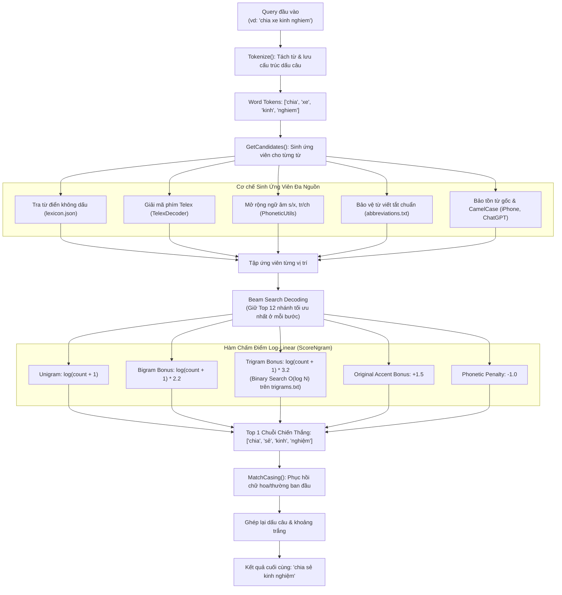

# HỆ THỐNG SỬA LỖI CHÍNH TẢ & KHÔI PHỤC DẤU TIẾNG VIỆT
### (Vietnamese Spell Checker & Accent Restoration with N-Gram Language Model)
> **Nền tảng:** C# (.NET 10)  
> **Giao thức:** ASP.NET Core Minimal Web API & Web UI Testing Playground  
> **Thuật toán cốt lõi:** Beam Search Decoding kết hợp N-gram (Trigram + Bigram + Unigram)  
> **Kỹ thuật tối ưu:** Binary Search $O(\log N)$ trực tiếp trên file đĩa 984 MB, bộ nhớ RAM siêu nhẹ (< 50 MB), độ trễ cực thấp (~23 ms / truy vấn).

---

## MỤC LỤC
1. [Giới thiệu Tổng quan](#1-giới-thiệu-tổng-quan)
2. [Sơ đồ Kiến trúc Hệ thống](#2-sơ-đồ-kiến-trúc-hệ-thống)
3. [Chi tiết Các Module Hoạt động](#3-chi-tiết-các-module-hoạt-động)
   - [Module 1: TextUtils (Tiền xử lý & Casing)](#module-1-textutilscs)
   - [Module 2: TelexDecoder (Giải mã gõ phím Telex)](#module-2-telexdecodercs)
   - [Module 3: PhoneticUtils (Mở rộng ngữ âm phương ngữ)](#module-3-phoneticutilscs)
   - [Module 4: NgramLanguageModel (Mô hình ngôn ngữ & Binary Search)](#module-4-ngramlanguagemodelcs)
   - [Module 5: VietnameseAccentRestorer (Beam Search Decoding)](#module-5-vietnameseaccentrestorercs)
4. [Ví dụ Minh Họa Từng Bước (Step-by-Step Walkthrough)](#4-ví-dụ-minh-họa-từng-bước)
5. [Hướng dẫn Cài đặt & Chạy Chương trình](#5-hướng-dẫn-cài-đặt--chạy-chương-trình)
6. [Báo cáo Hiệu năng & Kết quả Benchmark](#6-báo-cáo-hiệu-năng--kết-quả-benchmark)

---

## 1. Giới thiệu Tổng quan

Hệ thống được thiết kế nhằm giải quyết bài toán chuẩn hóa văn bản tiếng Việt tự động và sửa lỗi gõ phím theo thời gian thực (tương tự cơ chế của Google Gboard, Laban Key, Cốc Cốc).

Hệ thống xử lý triệt để **5 nhóm bài toán thực tế**:
1. **Lỗi gõ phím không dấu cơ bản:** `thoi tiet hom nay the nao` $\rightarrow$ `thời tiết hôm nay thế nào`.
2. **Lỗi gõ dính / sót phím Telex:** `tooi muon ddi hocj` $\rightarrow$ `tôi muốn đi học`, `nguwoif tieengs vietj` $\rightarrow$ `người tiếng việt`.
3. **Lỗi nhầm lẫn phụ âm tương đồng (ngữ âm phương ngữ):**
   - $s \leftrightarrow x$: `chia xe kinh nghiem` $\rightarrow$ `chia sẻ kinh nghiệm`, `xap xep` $\rightarrow$ `sắp xếp`.
   - $tr \leftrightarrow ch$: `cau truyen co tich` $\rightarrow$ `câu chuyện cổ tích`.
   - $d \leftrightarrow gi \leftrightarrow r$, $l \leftrightarrow n$.
4. **Lỗi nhầm lẫn dấu hỏi / ngã:** Dựa vào ngữ cảnh để tự sửa:
   - `uống sửa tươi` $\rightarrow$ `uống sữa tươi`.
   - `sữa xe máy` $\rightarrow$ `sửa xe máy`.
5. **Bảo toàn từ viết tắt & CamelCase:** Tích hợp hơn 18,000 từ viết tắt chuẩn từ `abbreviations.txt` (`AI`, `IT`, `TPHCM`, `UBND`...) và giữ nguyên các từ như `iPhone`, `ChatGPT`.

---

## 2. Sơ đồ Kiến trúc Hệ thống



---

## 3. Chi tiết Các Module Hoạt động

### Module 1: TextUtils.cs
Chịu trách nhiệm tiền xử lý văn bản và bảo toàn hình thái chữ:
* **`StripAccents(string text)`**: Chuẩn hóa văn bản sang dạng Unicode NFD để bóc tách các dấu thanh (`\u0300` đến `\u0323`), chuyển `đ/Đ` thành `d/D` và đưa về chuỗi không dấu chuẩn.
* **`MatchCasing(originalWord, candidateWord)`**: Khôi phục định dạng chữ hoa/thường:
  - Nếu từ gốc viết HOA (`HA NOI`) $\rightarrow$ trả về viết HOA (`HÀ NỘI`).
  - Nếu từ gốc viết hoa chữ đầu (`Ha Noi`) $\rightarrow$ trả về Title Case (`Hà Nội`).
  - Nếu từ gốc là **CamelCase** (`iPhone`, `ChatGPT`) $\rightarrow$ bảo tồn 100% không làm biến dạng.

---

### Module 2: TelexDecoder.cs
Chuyển đổi các chuỗi gõ phím lỗi Telex về từ tiếng Việt hợp lệ:
1. **Phụ âm:** Chuyển `dd` $\rightarrow$ `đ`.
2. **Bóc tách phím thanh Telex:** Nhận diện ký tự thanh ở đuôi từ: `s` (sắc), `f` (huyền), `r` (hỏi), `x` (ngã), `j` (nặng).
3. **Tổ hợp nguyên âm Telex:**
   - `aa` $\rightarrow$ `â`, `aw` $\rightarrow$ `ă`, `ee` $\rightarrow$ `ê`, `oo` $\rightarrow$ `ô`, `ow` $\rightarrow$ `ơ`, `uw` $\rightarrow$ `ư`.
   - Cụm `ươ`: Nhận diện các biến thể gõ nhanh `uwo`, `uow`, `uwow`, `ưo`, `uơ` $\rightarrow$ chuyển thành `ươ`.
4. **Quy tắc gán dấu thanh (`ApplyTone`):** Đặt dấu thanh vào đúng vị trí theo quy chuẩn ngữ pháp tiếng Việt.

---

### Module 3: PhoneticUtils.cs
Xử lý các lỗi nhầm lẫn phát âm phương ngữ (nghe sao viết vậy):
* Bảng tiền tố hoán đổi:
  - `s` $\leftrightarrow$ `x` (vd: `xe` $\rightarrow$ sinh thêm biến thể `se`).
  - `tr` $\leftrightarrow$ `ch` (vd: `truyen` $\rightarrow$ sinh thêm `chuyen`).
  - `d` $\leftrightarrow$ `gi` $\leftrightarrow$ `r` (vd: `da dinh` $\rightarrow$ sinh thêm `gia dinh`).
  - `l` $\leftrightarrow$ `n`.

---

### Module 4: NgramLanguageModel.cs
* **Unigram (`lexicon.json` - 200,841 từ):** Nạp vào RAM (chỉ tốn ~6 MB), tra cứu $O(1)$ tần suất của từng từ đơn lẻ.
* **Bigram (`bigrams.json` - 897,593 cặp từ):** Nạp vào RAM (~40 MB), tra cứu $O(1)$ tần suất cặp 2 từ đi liền nhau.
* **Trigram (`trigrams.txt` - 984 MB, 48 triệu dòng):**
  - **Không nạp file vào RAM** để tránh tốn 3–4 GB bộ nhớ.
  - Sử dụng thuật toán **Binary Search $O(\log N)$ trực tiếp trên file đĩa** thông qua `FileStream.Seek()`.
  - Tích hợp bộ nhớ đệm `ConcurrentDictionary` (LRU Cache tối đa 200,000 mục) giúp các truy vấn lặp lại đạt tốc độ **0.001 ms**.
* **Từ điển viết tắt (`abbreviations.txt` - 18,698 từ):** Tự động nạp vào RAM lúc khởi động (~1 MB), tra cứu $O(1)$ để bảo vệ các từ viết tắt chuyên ngành.

---

### Module 5: VietnameseAccentRestorer.cs
Điều phối thuật toán tìm kiếm tối ưu toàn cục:
1. **`Tokenize()`:** Dùng Regex `([^\w]+)` tách câu thành danh sách từ và mảng đánh dấu khoảng trắng/dấu câu, đảm bảo nguyên vẹn số, dấu phẩy, chấm than.
2. **`Beam Search Decoding`:** Duy trì `beamWidth = 12` chuỗi có điểm xác suất tích lũy cao nhất ở mỗi vị trí từ.

---

## 4. Hướng dẫn Cài đặt & Chạy Chương trình

Yêu cầu môi trường: Cài đặt **.NET 10 SDK** (hoặc .NET 8+).

Mở Terminal tại thư mục `c:\Users\Admin\Desktop\project\n-gram`:

### 1. Khởi động Web API & Giao diện Test trực quan:
```powershell
dotnet run
```
Sau đó mở trình duyệt truy cập: **`http://localhost:5000`**

### 2. Chạy Đánh giá Toàn diện (Benchmark):
```powershell
dotnet run -- --benchmark
```

### 3. Chế độ Tương tác Gõ trực tiếp (REPL):
```powershell
dotnet run -- --interactive
```

### 4. Chạy Thử nghiệm 1 Câu cụ thể:
```powershell
dotnet run -- --query "tooi muon ddi hocj tai TPHCM"
```
